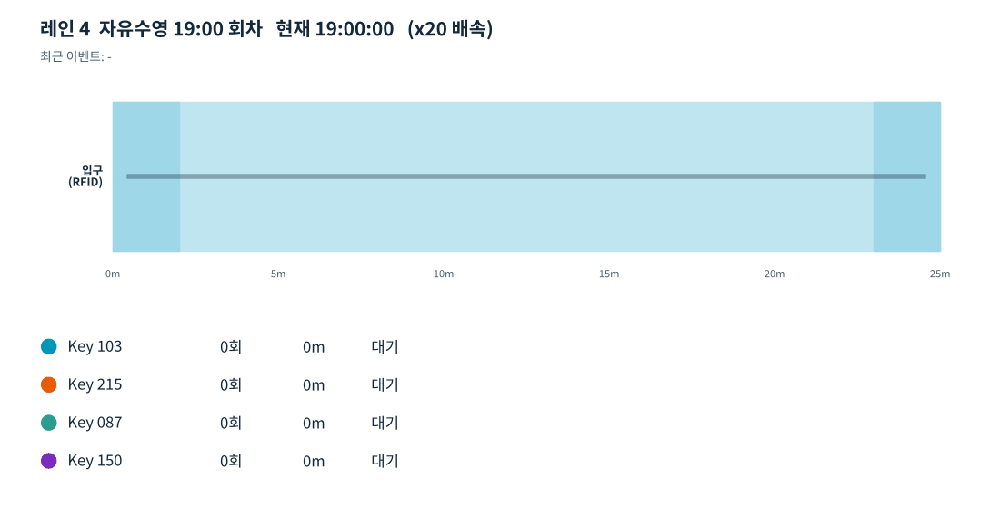
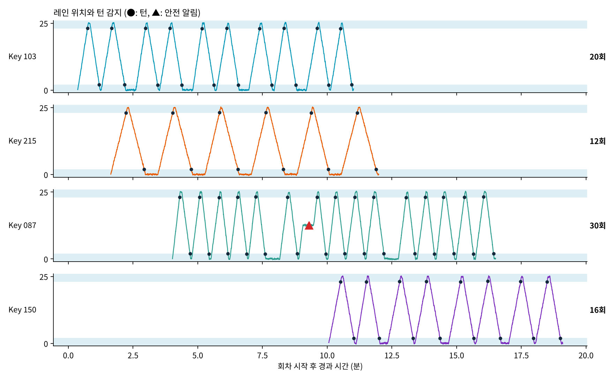

# 락커키 기반 자유수영 랩 자동 카운팅 시스템 (데모)

컴퓨팅기반 문제해결 개인 프로젝트 · 인공지능전공 92314952 이홍기

레인 입구에서 락커키(RFID)를 태그하면, 카메라가 추적한 위치 좌표로 편도(랩) 수를 자동으로 셉니다.
레인 중간에서 오래 멈추면 안전 알림을 내고, 퇴장 태그 때 요금과 운동 기록을 정산서로 출력합니다.
이번 구현에서는 RFID 태그와 카메라 좌표를 `simulator.py`가 가상으로 만듭니다.



## 실행 결과 요약

| 락커키 | 정답 편도 | 단순 방향 반전 | 제안 알고리즘 |
|---|---|---|---|
| 103 | 20 | 4,199 | 20 |
| 215 | 12 | 4,139 | 12 |
| 087 | 30 | 4,878 | 30 |
| 150 | 16 | 3,598 | 16 |

- 4명 78편도를 모두 정확히 집계
- Key 087: 레인 중간 13m 지점에서 25초 정지 → 15초 만에 안전 알림 (벽 휴식 오탐 0건)
- Key 150: 퇴장 태그 누락 → 19:50 회차 종료 시 마지막 검출 시각 기준으로 자동 저장
- Key 221: 태그 후 5초 안에 입장한 사람 없음 → 관리자 확인



## 실행 방법

```
pip install numpy matplotlib

python main.py                 # 터미널 데모: 이벤트 로그 + 정산서 + 정확도 + results 폴더 저장
python main.py --animate       # 터미널 데모 후 레인 애니메이션 창 (약 1분)
python main.py --animate --speed 40   # 애니메이션 배속 변경
python main.py --gif           # 애니메이션을 results/demo.gif 로 저장
```

`main.py`가 있는 폴더에서 실행하세요. 결과는 `results/` 폴더에 저장됩니다.

## 파일 구성

| 파일 | 역할 |
|---|---|
| main.py | 전체 실행 흐름, 화면 출력, 결과 저장 |
| config.py | 레인 길이, 매칭 시간, 벽 구간, 안전 알림 기준, 요금표 |
| simulator.py | 가상 시나리오(태그 기록, 노이즈·끊김이 있는 카메라 좌표) 생성 |
| tracker.py | 태그-수영자 매칭, 입장/퇴장 처리, 좌표 보간·평활화 |
| lap_counter.py | 턴 감지, 비교용 단순 방식, 안전 알림, 기록 분석 |
| checkout.py | 50분 회차 종료 처리, 요금 계산, 정산서 출력 (과제 4 연결) |
| viz.py | 결과 그래프 저장, 레인 애니메이션 |

## 결과 파일 (results/)

- `records.csv` : 락커키별 이용 시간, 편도 수, 거리, 평균·최고 편도, 결제 금액
- `event_log.txt` : 입장·퇴장·안전 알림·회차 종료 이벤트
- `lane_timeline.png` : 전체 수영자의 위치와 턴 감지
- `turn_detail.png` : 원본 좌표와 보정 좌표 비교
- `demo.gif` : 애니메이션 녹화본 (`--gif` 실행 시)
